# Vehicle Support and Repair Workflow — implementation plan

**Source**: *Vehicle Support and Repair Workflow* (manual booking), pasted by the
operator 2026-10-20.
**Status (2026-10-21)**: LIVE (server f23aca3, new-ui a1dde54, migration applied
2026-10-20 22:32 UTC). ONE ROAD (2026-10-21): the old outcome report and stage
buttons are retired (410/409), `/resolve` refuses 'fixed', the sweep takes open
legacy jobs into the workflow, and technicians have `POST /spot-fixes` (fixed on
the spot, no store part: born completed, ticketed, verified). Server:
migration `20261020180000_repair_workflow`, `src/modules/repairs/repairs.workflow*.ts`,
routes in `repairs.routes.ts`, grants in `lib/permissions.ts`. new-ui: the
Workshop screen (`WorkshopScreen.jsx`, nav key `workshop`, on `repair:read`),
`RepairWorkflowJob.jsx`, `FlagRepairDialog.jsx`, `api/repairWorkflow.js`.
Deviations from the plan below: a non-probe flag is `target_kind = 'unit'`
(covers tracker and sensor flags too), not `'mechanical'`; verification is
always on for flagged jobs (no `REPAIR_VERIFY_REQUIRED` flag; legacy jobs are
adopted, and `/resolve` closes only as unsuccessful); stores issues are recorded by hand (option A) until the
FactorySuite stores endpoint is confirmed (Q7b); the Flag action lives on the
Workshop screen, not yet in VehicleDetailPanel. Open questions in §9 were built
with their proposed defaults.
Originally written 2026-10-20
against `src/modules/repairs`, `src/modules/fuel` (Fuel Audit, probe hold) and
new-ui's Maintenance › Repairs and Fuel › Audit screens. Check `git log -- src/modules/repairs`
before trusting this status line (see the stale-status note in other docs here).
**Relation to `tech-resolution-process.md`**: that document's item 1 (a ticket
that exists before the technician arrives), item 5 (split spare states, Stores
role), item 6 (assignment and access gate) and item 7 (`void`) are all still
open. This plan supersedes those items with the new workflow's wording. It does
not replace the escalation sweep, the daily digest or the notify seam, which
are built and get reused here.

---

## 1 · What exists today (the foundation)

| Piece | Where | What it does |
| --- | --- | --- |
| Repair report + item | `repair_reports`, `repair_report_items` (migration 20260916120000 onward) | One technician visit = one report; one unit = one item (the **job**). One open job per target (partial unique index). |
| Stage ladder | `repairs.schema.ts` `STAGES` + CHECK (20260916140000) + new-ui label map | `pending → spare_outsourced → fixing → fixed / failed`. `fixed` only through `POST /items/:id/resolve` (needs `fixNote`). `stageHistory` JSONB records who, when and why for every move. |
| Outcomes | `outcome` column | `fixing`, `needs_spare`, `cannot_fix`, and `audit` (raised by Fuel Audit, nobody has visited yet → lands on `pending`). |
| Assignment | `assignedToId/At/ById`, `assignmentStatus` (20260919*) | Only `admin`/`super_admin` assign (`repairs.authz`), only a `technician` in the same org is assigned. Accept/decline via `/assignment-response`. A technician works only an accepted job of their own; `repair:work_any` lets other roles work any job. **No automatic assignment**: the operator removed it on purpose. |
| Overhaul audit | `repair_inspections`, `repair_spare_parts` (20260930200000, 20260930210000, 20261001100000) | A checklist of 5 probe components (probe, cable, bracket, tracker, calibration). Parts go `ordered → received (fixPlannedAt required) → fitted`, or `cancelled`. The job follows its parts. A job cannot be signed off fixed while a part is outstanding (`assertNoOutstandingParts`). |
| Fuel Audit link | `fuel_theft_followups.repair_item_id`, `fuel-followup.service` | Escalating a fuel alert with reason `probe_fault` raises (or joins) a probe job. A `fixed` sign-off closes its cases (`PROBE_FIXED`); `failed` leaves them open for a new job. |
| Probe reported mark | `fuel/probe-hold.ts` → `vehicle.probeHold` | An open probe job or a PROBE_FAULT case puts "Probe reported" on the tank gauge, the unit panel, the Units menu and the Alerts page. Alerts are no longer silenced (2026-10-13). |
| Notify seam | `repairs.notify.ts` | Every stage change, sign-off and escalation writes a durable feed item (+ mail where configured). |
| Escalation sweep + digest | `repairs.sweep.ts`, `REPAIR_ESCALATE_*` env | Daily: *stalled* (no movement for 3 days) and *overdue* (past expected date by 2 days), recorded on the trail and badged. A daily open-job digest. |
| Live sync | `repair_changed` SSE (`lib/sse.ts`, hooked in `repairs.routes.ts`) | Every successful write refreshes Repairs and Fuel Audit for the whole org. |
| Roles that matter | `lib/permissions.ts` | `technician` (narrow), `head_of_security` **exists** (fleet watch + fuel triage; no repair grants), `supervisor` and `operator` (both vehicle-scoped, neither has any `repair:*` grant), `admin`, `hos`, managers. ControlTech = the `controltech` **user group** (`seed-user-groups.ts`) + the `tech@controltech-ea.com` technician account. |
| Spare-part catalogue | new-ui `api/spareParts.js` | A **catalogue of part types, not an inventory**: no stock, no quantity, no store. |
| Vehicle status | `vehicles.status` | Owned by the provider registry (AVAILABLE / DISPATCHED / DECOMMISSIONED). Nothing here records "in repair". Maintenance › Service Status is mock data and hidden (`SHOW_SERVICE_STATUS = false`). |

The core decision of this plan: **the repair job (`repair_report_items`) stays
the single object.** The workflow's "repair ticket" is that same job once it
reaches the workshop: it gets a ticket number then, not a new table. Fuel Audit,
probe hold, the sweep, the SSE and the tracking line keep working because they
already key on the job.

---

## 2 · The workflow mapped, step by step

Key: **✔ exists** · **Δ change** · **＋ new**

| # | Workflow step | Today | Plan |
| --- | --- | --- | --- |
| 2 | Control Room operator/supervisor flags the unit with the suspected fault | Only technicians file reports (`repair:create`). Control-room roles have no repair grant. Fuel Audit raises an `audit` job, and that is the one existing "flag" path. | **＋** `POST /repairs/flags`: a one-item report with outcome `flagged`, landing on `pending` (same shape as the `audit` job). It takes a fault category plus a free-text suspected fault. **＋** permission `repair:flag` for the Control Room roles (`supervisor`, `fleet_analyst`, `operator`; answered 2026-10-20, §5). **Δ** `targetKind` gains `mechanical` for faults on the vehicle itself (engine, brakes, …), which are neither a probe nor a sensor-fault episode. **In scope by the operator's answer (2026-10-20): "mechanical faults".** |
| 2 | System forwards it to the technician through ControlTech | Assignment is manual, admin → named technician. Auto-assignment was removed on purpose. | **＋** **Routed by fault category** (§3.1). Telematics faults (fuel probe, tracker, sensor) go to the **ControlTech queue**, not to a person: `forwardedAt`, `queue = 'controltech'`, stage `forwarded`. Users in the `controltech` group with `technician` see the queue and **claim** a job. A claim is a self-assignment, recorded as already accepted. **Mechanical faults go to the workshop**: `queue = 'workshop'`, `path` preset to `physical`, straight to `awaiting_assessment`. ControlTech fit trackers and probes and cannot fix a gearbox remotely, so there is no remote decision for them to make. ControlTech still gets an info feed item for awareness (Q2). Admin hand-assignment stays as it is. |
| 2 | Technician decides remote vs physical | — | **＋** `path` column: `remote` / `physical`, set by the claiming technician with a note (telematics faults only). Stage `remote_fix` or `needs_physical`. |
| 2.1 | Remote fix → technician marks fixed, tells the Control Room, system shows the corrected status | Resolve → `fixed`, a feed item, probe hold lifts. | **Δ** Resolve becomes **complete** (stage `completed`, awaiting verification, see step 6). The feed item goes to the Control Room. "Corrected status" = the unit's service mark clears on verify (§5). |
| 2.1 | Remote impossible → technician tells the Control Room to book a physical inspection | — | **＋** `path → physical` moves to `awaiting_assessment` and notifies the Control Room. |
| 3 | Control Room decides whether the unit can reach the Auto Workshop | — | **＋** `POST /items/:id/assessment`: `roadworthy` (bool), `intervention` (`workshop` / `tow` / `field_inspection`), plus a `reason` that is **required when not roadworthy**. Records who and when, and is kept on the trail for accountability. |
| 3A | Roadworthy → book at the workshop, at most 3 units a day | — | **＋** `workshop_bookings` with a daily capacity of **3 vehicles per day** (operator, 2026-10-20), enforced in a transaction (§3.3). It is held as a column so it can change without a migration. Stage `booked`. The booking dialog shows the next free days. |
| 3B | Not roadworthy → record the reason, tow or inspect on the field | — | **＋** The same assessment row with `intervention = tow / field_inspection`, plus `interventionDetail` (tow provider, location, who goes). Stage `towing` / `field_inspection`. **Not counted against the 3/day cap**: the rule caps *bookings* of vehicles driven in, and a tow or field visit is not a booking. A towed unit that arrives does take a workshop bay, so the arrival is shown on the workshop day board even though it holds no slot (§3.3). |
| 4 | Workshop: raise a repair ticket number on arrival | — | **＋** `POST /items/:id/arrive` issues `ticket_no` (unique, from a Postgres sequence) and moves the stage to `in_workshop`. The booking becomes `arrived`. |
| 4 | Assign a technician | ✔ machinery exists (assign / accept) | **Δ** A second assignee slot, `workshopTechnicianId`, so the ControlTech technician who triaged stays on the record. For mechanical work this is a **workshop mechanic**, not ControlTech. For telematics work it may be the same ControlTech technician. Whether mechanics are app users is Q4. |
| 4 | Inspect; genuine vs suspected-malicious damage | ✔ inspection checklist, probe-only | **Δ** The checklist becomes **per fault category**, with mechanical lists added (§3.1, Q8). **＋** `damageClass` (`genuine` / `suspected_malicious`), `damageNote`, classifiedBy/At. Required before parts can be issued or the job completed. |
| 4.1 | Genuine → diagnose, repair, decide parts | partly (`problemNote`, parts) | **＋** `diagnosis` text. Parts as in step 5. |
| 4.2 | Malicious → notify Head of Security, document on ticket, mark warranty void, still repair, investigation tracked separately | `head_of_security` role exists; nothing links it to repairs | **＋** A `security_investigations` table linked to the job, opened automatically on `suspected_malicious`, with its own status. It never gates the job. **＋** `warrantyVoid` + `warrantyVoidNote` + `warrantyVoidComponents` on the job: the **warranty** of the damaged unit/components, not an insurance policy (answered 2026-10-20, §3.1). **＋** Notifications to every live `head_of_security` holder in the org (feed + mail). |
| 5.1 | In stock → check inventory, issue, install, record on ticket | Parts are always "ordered". No inventory. | **＋** Part `source = 'inventory'`, status `issued → fitted`, `issuedBy/At`, `fsStore`, `fsIssueId`. **Stock is read from RaiFactorySuite** (answered 2026-10-20, §3.5); the endpoint is unconfirmed (Q7b). |
| 5.2 | Not in stock → record missing parts, tell ControlTech, they source, repair, record parts and work | ✔ `ordered → received → fitted` with supplier, promised date and cost | **Δ** New first status `requested` (named, not yet ordered) with `source = 'controltech'`. Notify the ControlTech group. ControlTech moves it to `ordered` (supplier, ref, promised date), then the existing lifecycle continues. |
| 6 | Technician tests, marks ticket completed with work and parts, notifies the channel and the Control Room | Resolve = terminal `fixed` with `fixNote` | **Δ** Resolve becomes **complete**: `testResult` (`pass` / `fail`), `testNote`, `fixNote`, stage `completed`, `completedBy/At`. No outstanding parts allowed (existing rule). **＋** a `repair_work_entries` work log (§3.6). Notify the Control Room and the channel, which is **in-app notifications + email** (answered 2026-10-20, §6). |
| 6 | Control Room verifies and updates the unit status → fixed/available | — | **＋** `POST /items/:id/verify` (`accept` / `reject` + note). Accept → `fixed`, `resolvedAt` set, then the **existing** sign-off chain runs (Fuel Audit closes, probe hold lifts, SSE). Reject → back to `fixing` with the reason, and the technician is notified. |
| 7 | Ticket keeps fault, assignment, diagnosis, damage class, parts, actions, final status | Spread over the job, trail, inspections and parts | **＋** `GET /items/:id/ticket`, one read assembling all of it (also the PDF/print view, §6). |
| 8 | Rules | — | Each rule has a home: cap → §3.3; immobile assessed → the assessment reason CHECK; unique ticket → unique index; malicious → investigation never gates; all parts on the ticket → parts FK to the job + no completion with unrecorded parts; final status matches the technician → the verify step. |

### 2a · The whole workflow as a flowchart

Green = **exists** today, amber = **changed**, blue = **new**. The security
track (dashed) runs beside the repair and never feeds back into it.

```mermaid
flowchart TD
  classDef exists fill:#dcfce7,stroke:#16a34a,color:#14532d
  classDef changed fill:#fef3c7,stroke:#d97706,color:#78350f
  classDef new fill:#dbeafe,stroke:#2563eb,color:#1e3a8a

  A["Control Room flags unit<br/>supervisor · analyst · operator<br/>POST /flags · stage pending"]:::new
  A0["Automatic sources<br/>probe health · Fuel Audit probe_fault"]:::exists
  A0 -.-> A
  B["Forward to ControlTech queue<br/>stage forwarded"]:::new
  C["ControlTech technician claims job<br/>self-assign, accepted"]:::changed
  D{"Remote or physical?<br/>path column"}:::new

  A1{"Fault category?<br/>routes the job"}:::new
  A --> A1
  A1 -- "telematics: probe, tracker, sensor" --> B
  A1 -- "mechanical: engine, brakes, ...<br/>path preset physical" --> E
  B --> C --> D

  R1["Fix remotely<br/>stage remote_fix"]:::new
  R2{"Remote fix worked?"}:::new
  D -- remote --> R1 --> R2
  R2 -- yes --> T
  R2 -- "no: tell Control Room" --> E

  E["Control Room assesses<br/>supervisor<br/>stage awaiting_assessment"]:::new
  D -- physical --> E
  F{"Can it safely reach<br/>the Auto Workshop?"}:::new
  E --> F

  G["Book workshop slot<br/>max 3 vehicles per day<br/>stage booked"]:::new
  G1["Workshop full<br/>offer next free day"]:::new
  F -- "yes: roadworthy" --> G
  G -. full .-> G1 -.-> G

  H["Record reason (required)<br/>decide intervention"]:::new
  H1["Tow to workshop<br/>stage towing<br/>holds no booking slot"]:::new
  H2["On-field inspection<br/>stage field_inspection"]:::new
  F -- "no: immobile" --> H
  H --> H1
  H --> H2

  I["Arrival: issue unique<br/>repair ticket number<br/>stage in_workshop"]:::new
  G --> I
  H1 --> I
  H2 --> J

  J["Assign technician<br/>mechanical: workshop mechanic<br/>telematics: ControlTech"]:::changed
  I --> J
  K["Inspect unit<br/>checklist per fault category<br/>incl. mechanical"]:::changed
  J --> K
  L{"Damage classification"}:::new
  K --> L

  M["Genuine:<br/>diagnose, repair"]:::new
  L -- genuine --> M

  S1["Suspected malicious:<br/>document on ticket"]:::new
  L -- suspected malicious --> S1
  S1 --> M
  S2["Notify Head of Security<br/>role head_of_security"]:::new
  S3["Mark warranty void<br/>damaged unit or components"]:::new
  S4["Security investigation<br/>tracked separately<br/>never blocks the repair"]:::new
  S1 -.-> S2 -.-> S4
  S1 -.-> S3

  N{"Spare parts needed?"}:::changed
  M --> N
  P{"In stock?"}:::new
  N -- yes --> P
  P1["Issue from stores<br/>stock read from FactorySuite<br/>part status issued"]:::new
  P -- yes --> P1
  P2["Record missing parts<br/>part status requested"]:::new
  P3["ControlTech sources part<br/>ordered → received"]:::changed
  P -- no --> P2 --> P3
  P4["Install, record part<br/>on the ticket · fitted"]:::exists
  P1 --> P4
  P3 --> P4
  W["Repair + work log<br/>stage fixing"]:::changed
  N -- no --> W
  P4 --> W

  T["Technician tests and completes<br/>test result, work, parts<br/>stage completed"]:::changed
  W --> T
  U["Notify Control Room<br/>+ communication channel"]:::changed
  T --> U
  V{"Control Room verifies (supervisor):<br/>matches technician's outcome?"}:::new
  U --> V
  V -- "reject + reason" --> W
  X["Unit fixed and available<br/>stage fixed · Fuel Audit closes<br/>Probe reported lifts"]:::changed
  V -- accept --> X
```



Reading the colours against today's code: the claim reuses the existing
assign/accept machinery (changed); the inspection checklist exists but is
probe-only (changed); `ordered → received → fitted` exists, with `requested` and
`issued` added in front (changed/new); complete and verify split today's
single `/resolve` sign-off (changed + new); the final `fixed` step reuses the
existing Fuel Audit close and probe-hold lift, now triggered by verification.

---

## 3 · Data model and migrations

All migrations use the house recipe (`SET lock_timeout = '5s'`, additive, CHECKs
restated in zod and the new-ui label map). They are applied on the box with the
scratch-dir recipe *before* the server deploy. Each table carries a partial
index that Prisma cannot express, documented on the model as the existing ones
are.

### 3.1 `repair_report_items` — new columns (migration `…_repair_workflow_job`)

| Column | Type | Notes |
| --- | --- | --- |
| `fault_category` | text, null | See the category table below (CHECK). Drives the routing, the checklist and who the workshop technician is. Required on outcome `flagged`. |
| `suspected_fault` | text, null | What the Control Room saw. Required on outcome `flagged`. |
| `queue` | text, null | `controltech` / `workshop`, set from the category on flagging. Null = hand-assigned only (all existing jobs). |
| `forwarded_at` | timestamptz, null | |
| `path` | text, null | `remote` / `physical` (CHECK). |
| `path_note`, `path_decided_by_id`, `path_decided_at` | | |
| `ticket_no` | text, null, **UNIQUE** | Issued on workshop arrival (or on tow/field start, Q3a). Format `RT-{YYYY}-{seq:05}` from sequence `repair_ticket_seq`. Never reused, never edited. |
| `workshop_technician_id` | text FK users, null | Second assignee slot. |
| `diagnosis` | text, null | |
| `damage_class` | text, null | `genuine` / `suspected_malicious` (CHECK). |
| `damage_note`, `damage_classified_by_id`, `damage_classified_at` | | `damage_note` required when malicious (CHECK). |
| `warranty_void` | boolean, default false | **Warranty**, not insurance (operator, 2026-10-20: "warranty"). It marks the warranty on the damaged unit / equipment as void because of suspected malicious damage. Setting it requires `damage_class = 'suspected_malicious'` (CHECK). |
| `warranty_void_note` | text, null | Required when `warranty_void` (CHECK). |
| `warranty_void_components` | text[], null | Which components' warranty is void, from the job's checklist vocabulary (e.g. `{probe, probe_cable}` or `{gearbox}`). Empty = the whole unit. |
| `warranty_voided_by_id`, `warranty_voided_at` | | Who marked it, and when. Clearing writes a trail entry; the columns are not overwritten silently. |

**Job or part? Proposed: on the job.** Malicious damage voids the warranty of
what was *damaged*: the unit, or components already fitted to it. That belongs
to the job, which names the unit and its inspected components. It does not
belong to the spare parts row, which holds the *new* parts fitted in the repair,
and those come with a fresh warranty of their own that the malice did not touch.
`warranty_void_components` narrows the void to the damaged components without
needing a per-part flag. If the business also tracks warranty on parts that
were fitted earlier (e.g. a probe replaced last month under warranty and now
smashed), that is the same component list. A per-part `warranty_void` on
`repair_spare_parts` is only needed if a part *issued in this repair* can lose
its warranty, which the workflow does not describe (Q6a).
| `completed_at`, `completed_by_id`, `test_result`, `test_note` | | Technician's completion. |
| `verified_at`, `verified_by_id`, `verify_note` | | Control Room's verification. |
| `void_reason`, `preceded_by_id` | | Closes `tech-resolution-process` item 7 while we are in here. |

**Outcome CHECK** gains `flagged`. **targetKind CHECK** gains `mechanical`. The
one-open-job-per-target index needs a `mechanical` key: proposed as
`(vehicle_id, fault_category)` for `mechanical` items. A unit can then have an
open brake job and an open engine job at once, but not two brake jobs.

**Fault categories, routing and checklist** (mechanical faults are in scope:
operator, 2026-10-20). Categories map to a queue and a starting path:

| Group | `fault_category` | Queue | Starts at | Workshop technician | Checklist components (proposal, Q8) |
| --- | --- | --- | --- | --- | --- |
| Telematics | `fuel_probe` | `controltech` | `forwarded` (remote/physical decided by ControlTech) | ControlTech technician | probe, probe_cable, tank_bracket, tracker, calibration *(today's five)* |
| Telematics | `tracker` | `controltech` | `forwarded` | ControlTech technician | tracker, antenna, power_feed, sim, wiring |
| Telematics | `sensor` | `controltech` | `forwarded` | ControlTech technician | sensor, wiring, connector, calibration |
| Mechanical | `engine` | `workshop` | `awaiting_assessment` (path = physical) | Workshop mechanic | engine, cooling, fuel_system, air_intake, exhaust |
| Mechanical | `transmission` | `workshop` | `awaiting_assessment` | Workshop mechanic | gearbox, clutch, driveshaft, differential |
| Mechanical | `brakes` | `workshop` | `awaiting_assessment` | Workshop mechanic | pads_shoes, discs_drums, air_hydraulic_lines, handbrake |
| Mechanical | `suspension_steering` | `workshop` | `awaiting_assessment` | Workshop mechanic | springs, shocks, steering_box, linkages |
| Mechanical | `tyres` | `workshop` | `awaiting_assessment` | Workshop mechanic | tyres, wheels, hubs_bearings |
| Mechanical | `electrical` | `workshop` | `awaiting_assessment` | Workshop mechanic (auto-electrician) | battery, alternator, starter, lighting, wiring |
| Mechanical | `hydraulics` | `workshop` | `awaiting_assessment` | Workshop mechanic | pump, rams, hoses, valves *(plant units, e.g. KASULU)* |
| Mechanical | `body` | `workshop` | `awaiting_assessment` | Workshop mechanic | cab, body_panels, glass, trailer_coupling |
| Either | `other` | chosen by the flagger | as chosen | as chosen | free-text only |

The checklist moves **from a CHECK to data.** Today `repair_inspections.component`
is a 5-value CHECK (migration 20260930200000). The migration drops it, and the
allowed components per category live in `repairs.schema.ts` (zod) and the new-ui
label map. They will grow with the workshop's own forms, and a CHECK change per
new component is the wrong cost. Existing probe rows stay valid because the five
probe components are kept as they are. `fault_category` is backfilled to
`fuel_probe` on existing `probe` / `fuel_probe_dead` jobs and to `sensor` on
other fault-episode jobs, so old jobs pick the right checklist.

Mechanical faults also change three smaller things:
- `probe-hold.ts` keys on probe jobs only, so a brake job must not raise
  "Probe reported". It already filters on `target_kind = 'probe'` /
  `fault_kind = 'fuel_probe_dead'`, so no code change is needed. A test pins it.
- The Fuel Audit close (`applyRepairSignOff`) only touches cases linked to the
  job, so a mechanical job closes no fuel case. No change is needed.
- The unit's service mark (§3.7) is wider than "Probe reported": it reads
  "In workshop" / "Repair flagged" for any category.

**Stage CHECK** becomes (old values kept, so no existing row changes):

```
pending            flagged / audit, nobody has it yet
forwarded          in the ControlTech queue, unclaimed (telematics only;
                   mechanical flags skip to awaiting_assessment)
remote_fix         claimed, technician working remotely
awaiting_assessment  physical needed; Control Room to assess
booked             workshop slot held
towing | field_inspection
in_workshop        arrived; ticket number issued
spare_outsourced   (existing) waiting on parts
fixing             (existing) work under way
completed          technician done + tested; awaiting Control Room
fixed | failed     (existing) terminal after verification
void               raised in error / duplicate
```

`fixed` stays reachable only through a route that demands an account. That
route moves from `/resolve` to `/verify`, and the Postgres rule moves with it:
`fixed ⇒ verified_at IS NOT NULL` once the flag in §8 is on.

### 3.2 `repair_assessments` (new)

One row per assessment (a unit can be reassessed, e.g. a tow that turns into a
workshop booking). Columns: `id, organisation_id, repair_item_id, roadworthy bool,
intervention ('workshop'|'tow'|'field_inspection'), reason text, intervention_detail
jsonb (tow provider, pickup location, field team), assessed_by_id, assessed_at`.
CHECK: `roadworthy OR reason IS NOT NULL`; `NOT roadworthy OR intervention = 'workshop'`.

### 3.3 `workshops` + `workshop_bookings` (new)

- `workshops`: `id, organisation_id (null = shared), name, daily_capacity int default 3, location, is_active`.
  **3 vehicles per day** is the operator's figure (2026-10-20). It is the
  workshop's daily *intake of booked vehicles*, kept as a column so it can be
  changed without a migration. Seeded with one "Auto Workshop" per org, or one
  shared one: still open (Q5a).
- `workshop_bookings`: `id, workshop_id, repair_item_id, booking_date DATE, status
  ('booked'|'arrived'|'cancelled'|'no_show'), booked_by_id, booked_at, arrived_at, cancel_reason`.
  Partial unique index: one live booking per job.

**Enforcing the cap.** `INSERT` inside a transaction that first takes
`pg_advisory_xact_lock(hashtext(workshop_id || booking_date))`, counts live
bookings (`status IN ('booked','arrived')`) for that day, and refuses with a
409 *"Workshop full on 2026-10-22 — next free day is 2026-10-23"* when
`count >= daily_capacity`. The cap is a column, not a CHECK, so it can be
changed without a migration. The advisory lock is what makes two simultaneous
bookings for the last slot safe. `GET /workshops/:id/availability?from&days=14`
returns free slots per day for the booking dialog.

**What counts.** Only `workshop_bookings` rows count, and only bookings of a
roadworthy vehicle make one. A tow or a field inspection holds no slot, because
the rule is about how many vehicles are *booked in* a day. A towed unit arriving
is still recorded (`arrive` issues its ticket) and appears on the day board as
"arrived, unbooked", so a day with 3 bookings and a tow is visibly a busy day.
If the workshop wants towed arrivals to consume a slot as well, it is a one-line
change to the count (Q5a).

### 3.4 `security_investigations` (new)

`id, organisation_id, repair_item_id (unique), vehicle_id, opened_at, opened_by_id,
status ('open'|'investigating'|'closed_confirmed'|'closed_unfounded'),
assigned_to_id (a head_of_security holder), findings text, closed_at, closed_by_id,
history jsonb` (same trail shape as `stageHistory`).

It is opened in the same transaction that sets `damage_class = 'suspected_malicious'`.
It is deliberately **not** consulted by any repair guard. That non-coupling is
pinned by a unit test so nobody adds a gate later. Reclassifying to `genuine`
does not delete it; it is closed as `closed_unfounded` with the note.

### 3.5 `repair_spare_parts` — extended (migration `…_repair_parts_source`)

- `source` text default `'controltech'` (`'inventory'|'controltech'`). Existing rows
  are outsourced orders, so the default is correct for them.
- Status CHECK gains `requested` (named, ControlTech not yet ordered) and `issued`
  (handed out from stores). Lifecycles:
  - inventory: `issued → fitted` (or `cancelled` = returned to stores)
  - controltech: `requested → ordered → received → fitted` (or `cancelled`)
- New columns: `issued_by_id, issued_at, fs_store, fs_item_code, fs_issue_id, order_ref, requested_at`.
- `assertNoOutstandingParts` extends to `requested` and `issued`.

**Inventory comes from FactorySuite** (operator, 2026-10-20: "store or inventory
we can pull from factory suite"). We do **not** build our own stock tables, so the
earlier option B is dropped. We read stock from RaiFactorySuite and record the
issue against the ticket here.

*What the integration already has.* `src/providers/raifactorysuite/raifactorysuite.client.ts`
talks to `https://factorysuite.org/api/external/v1` with an `X-API-Key` header
(`RAIFACTORYSUITE_API_URL` / `_API_KEY`). It has a 20 s timeout per request and
copes with bare-array vs `{ data }` responses and offsetless local timestamps
(`lib/provider-time`). Today it reads `/machines` (the register,
synced hourly by the reconciler, `raifactorysuite.machine-sync.ts`), `/dispatches`,
`/sales` and `/weighment/cane-delivery` / `cane-transfer`. Pushes arrive inbound
on `POST /webhook/rai` (HMAC, `middleware/webhookAuth`). **Everything is
read-only today**: nothing in this codebase writes to FactorySuite.

*Endpoint status: UNCONFIRMED.* No stores or inventory endpoint is documented in
`docs/LIVE_INTEGRATION.md` §3.1 or used anywhere in the client, so we don't yet
know whether one exists (Q7). What this workflow needs from it:

| Need | Shape we would want | Why |
| --- | --- | --- |
| **Part catalogue** | `GET /stores/items?factoryCode=` → `{ itemCode, name, unit, category }` | Replaces the hard-coded catalogue in new-ui `spareParts.js` (its docblock already expects a fetch). `itemCode` is stored on the part row so issues reconcile. |
| **Stock on hand** | `GET /stores/stock?itemCode=&store=` → `{ itemCode, store, qtyOnHand, asOf }` | "Check the inventory" (§5.1). Read live when the technician picks a part, and cached a few minutes. In stock → *Issue from stores*; out → *Request via ControlTech* (§5.2). |
| **Issue against a ticket** | `POST /stores/issues { itemCode, qty, store, reference: ticket_no, vehicle plate, issuedBy }` → `{ issueId }` | Only if FactorySuite accepts writes. Our `issued` part row stores the returned `issueId`. Without it, the stores clerk issues in FactorySuite with the ticket number as reference, and we **match** the issue back. |
| **Issues feed** (if no write) | `GET /stores/issues?since=` or a webhook event `STORES_ISSUE` with the reference | Lets the reconciler turn a FactorySuite issue carrying `RT-2026-…` into our part row (`issued`, `fs_issue_id`), so "all parts recorded against the ticket" holds even when the issue was keyed there. |
| **Returns** | the same feed, `qty < 0` or a `RETURN` type | `cancelled` = returned to stores. |

*Does issuing write back?* That is a FactorySuite question, and it decides the
build:

- **Write-back available**: Issue from stores in our app calls FactorySuite and
  stores the `issueId`. It is our **first write** to FactorySuite, so it needs
  its own key scope, an idempotency key (the part row id), and failure handling
  (the part stays `requested`, a toast says why, and a retry is safe).
- **Read-only** (the likely case, matching every endpoint today): stores stay the
  system of record for stock movements. Our app shows stock and records *that* a
  part was issued, and the reconciler confirms it against FactorySuite's own issue
  by ticket number. A part issued here with no matching FactorySuite issue after N
  hours is flagged on the ticket.

Part rows carry `fs_item_code`, `fs_issue_id` and `fs_store` (listed above). If
no inventory endpoint exists at all, the fallback is option A: record the issue
by hand with a reference, and
no stock check.

### 3.6 `repair_work_entries` (new)

The "repair actions" of the ticket: `id, repair_item_id, at, by_id, by_name, kind
('diagnosis'|'repair'|'test'|'note'), text, labour_minutes int null`. Append-only.
The inspection checklist stays as the per-component state, and this is the
narrative log.

### 3.7 Unit service state (no column)

Derived like `probeHold`: `serviceState` on each vehicle =
`in_workshop` / `awaiting_repair` / `awaiting_verification` / null, from its open
jobs, computed in one query next to `probeHoldVehicleIds` and served on the same
vehicle payloads. **Not** written into `vehicles.status`, which the provider registry
owns and the sync would overwrite. Whether FactorySuite should be told is Q10.

---

## 4 · API

All under `/organisations/:orgId/repairs`, all writes `requirePermissionStrict`
(same reasoning as the route header) and all inside the existing
`repair_changed` broadcast hook.

| Method + path | Permission | Does |
| --- | --- | --- |
| `POST /flags` | `repair:flag` | Flag one or more units. Creates the job(s) with outcome `flagged`, stage `pending`, and forwards to the ControlTech queue in the same call (`forward: true` default). |
| `POST /items/:id/forward` | `repair:flag` | Forward a pending/audit job that was not forwarded (e.g. old jobs, Fuel Audit). |
| `GET /queue` | `repair:claim` | The ControlTech queue: forwarded, unclaimed. |
| `POST /items/:id/claim` | `repair:claim` | Self-assign (accepted), refused if already claimed (guarded update). |
| `POST /items/:id/path` | `repair:resolve` + workable | `remote` / `physical` + note. |
| `POST /items/:id/assessment` | `repair:assess` | §3.2 row, moves to `booked`-pending / `towing` / `field_inspection`. |
| `GET /workshops`, `GET /workshops/:wid/availability` | `repair:read` | Capacity view. |
| `POST /items/:id/booking` / `DELETE …/booking` | `repair:book` | Book / cancel (cancel needs a reason). |
| `POST /items/:id/arrive` | `repair:book` or `repair:workshop` | Issues `ticket_no`, `in_workshop`. Idempotent: a second call returns the same number. |
| `POST /items/:id/workshop-assign` | `repair:assign` (Q4) | Workshop technician. |
| `POST /items/:id/damage` | `repair:resolve` + workable | Class + note (+ diagnosis). Opens the investigation when malicious. |
| `POST /items/:id/warranty-void` | `repair:resolve` to set; clearing per Q6a (proposed `security_case:update`) | Set / clear with a note and the affected components. |
| `POST /items/:id/parts` (Δ) | `repair:resolve` + workable | Gains `source`. Inventory parts start `issued` only for `repair:parts_issue` holders; others create `requested`. |
| `POST /items/:id/parts/:pid` (Δ) | as today; `ordered` needs `repair:parts_source` | New statuses. |
| `POST /items/:id/work` | `repair:resolve` + workable | Work-log entry. |
| `POST /items/:id/complete` | `repair:resolve` + workable | Replaces `/resolve` (kept as an alias during rollout). Test result + notes. |
| `POST /items/:id/verify` | `repair:verify` | Accept → `fixed` + existing sign-off chain. Reject → `fixing`. |
| `POST /items/:id/void` | `repair:verify` | Void with a reason (+ `precededBy`/duplicate link). |
| `GET /items/:id/ticket` | `repair:read` | The full ticket (§2 step 7). |
| `GET /security-investigations`, `POST …/:id` | `security_case:read` / `security_case:update` | Head of Security's list and updates. |

`effective-stage.ts` keeps auto-advancing `spare_outsourced → fixing` on read.
The new stages are never derived.

---

## 5 · Roles and permissions

New slugs (catalogue + migration granting them, like `20261001120000_repair_work_any`):

| Slug | Meaning | Granted to (proposal) |
| --- | --- | --- |
| `repair:flag` | Flag a unit, forward it by category | Control Room: `supervisor`, `fleet_analyst`, `operator`; also `admin`, `hos`, managers |
| `repair:assess` | Roadworthy / intervention decision | `supervisor` (+ `admin`); see the recommendation below |
| `repair:book` | Book / cancel / record arrival | Control Room: `supervisor`, `fleet_analyst`, `operator`; workshop lead |
| `repair:claim` | See and claim the ControlTech queue | `technician` (in practice the `controltech` group) |
| `repair:verify` | Verify completion, void | `supervisor` (+ `admin`); see the recommendation below |
| `repair:parts_issue` | Record an issue from stores (or the FactorySuite write, Q7b) | new `stores` role |
| `repair:parts_source` | Move a requested part to ordered/received | `technician` in `controltech`, `admin` |
| `security_case:read` / `security_case:update` | Investigations | `head_of_security` (both), `asst_head_of_security` (read), `admin` |

**The Control Room is three existing roles** (operator, 2026-10-20: "supervisor,
analyst, and operator"). There is no plain `analyst` slug in `lib/permissions.ts`.
The role is `fleet_analyst` ("Fleet Analyst"), so that is the one meant. As
they stand today:

| Role | Scope | Repair grants today | What it gets here |
| --- | --- | --- | --- |
| `supervisor` | **vehicle-scoped**; tracking, map tools, dashboard, trips | none | `repair:read`, `flag`, `book`, `assess`, `verify` |
| `fleet_analyst` | **org-wide** (deliberately not scopable); reads and exports everything, *"Changes nothing."* | none | `repair:read`, `flag`, `book` |
| `operator` | **vehicle-scoped**; weighbridge + live snapshot only, no map, no `sensor:read` | none | `repair:read`, `flag`, `book` |

All three get `repair:read`, `repair:flag` and `repair:book`. **Recommendation:
narrow `assess` and `verify` to `supervisor`** (plus `admin`) rather than all three:

- *Assess* is a safety call: "this vehicle can be driven to the workshop". It is
  the decision the workflow asks to be accountable for, and the supervisor is the
  one the workflow names alongside the operator.
- *Verify* is rule 8's check that the final status matches the technician's
  outcome. It is worth more when a more senior person makes it than the operator
  who flagged the unit. The server also refuses a verify by the person who
  completed the job.
- `fleet_analyst` is documented in code as a role that writes nothing ("an analyst
  who can amend a trip is an analyst whose figures nobody can trust"). Flag and
  book are its **first write verbs**: a deliberate change of that contract that the
  role's comment and `tests/unit/permissions-matrix` must be updated to say.
  Giving it assess/verify as well would make it a decision-maker, which goes
  further than the user's answer needs.

If the user wants all three to assess and verify, it is a grant-list change in
the same migration and nothing else moves.

Things to watch:

- `supervisor` and `operator` are **vehicle-scoped**, `fleet_analyst` is not.
  Flag, book, assess and verify must respect the vehicle scope for the first two
  (a scoped operator flags only their own units), and the Repairs list must filter
  to their units. Otherwise a scoped supervisor sees every job in the org, the
  same trap the analytics comments describe. The analyst sees the whole org's jobs.
- `operator` has no `sensor:read` and no map today, so the Flag action must live
  on screens it can open (the Units menu / unit panel via `vehicle:read`), and
  Maintenance › Repairs must open on `repair:read` alone, not on `sensor:read`.
- `head_of_security` gets `repair:read` scoped to jobs linked to an
  investigation only, not the whole board, unless the operator says otherwise.
- `repairs.authz` keeps its assigner/assignee rule. Claiming is a separate path
  and does not widen who an admin may assign.
- Permission grants are served from the authz cache for up to 5 min after a
  grant migration, so plan the first test accordingly.

---

## 6 · Notifications

All through `repairs.notify.ts` (one function per event; durable feed item with a
deterministic id, mail where an address exists). New events:

**The "communication channel" is in-app notifications plus email** (operator,
2026-10-20). So every ✔ below is a durable feed item **and** a mail to the
recipients' account addresses. There is no separate channel to build. The
Channel column is the org-wide copy: a feed item for the whole org plus a mail to
`REPAIR_NOTIFY_EMAILS`.

| Event | Control Room | ControlTech queue | Assigned tech | Head of Security | Stores | Channel (in-app + email) |
| --- | --- | --- | --- | --- | --- | --- |
| Flagged + forwarded | ✔ | ✔ | — | — | — | — |
| Claimed / path chosen | ✔ | — | — | — | — | — |
| Remote impossible → assess | ✔ (warning) | — | — | — | — | — |
| Assessed not roadworthy (tow/field) | ✔ | ✔ | — | — | — | ✔ |
| Booked / booking refused (full) | ✔ | — | ✔ | — | — | — |
| Arrived, ticket issued | ✔ | — | ✔ | — | — | ✔ |
| Suspected malicious | ✔ | — | — | ✔ **mail + feed, critical** | — | — |
| Warranty marked void | ✔ | — | — | ✔ | — | — |
| Part requested (ControlTech) | — | ✔ | — | — | — | — |
| Part requested from stores | — | — | — | — | ✔ | — |
| Part issued / received | — | — | ✔ | — | — | — |
| Completed, awaiting verify | ✔ (warning) | — | — | — | — | ✔ |
| Verified fixed / rejected | ✔ | — | ✔ | — | — | ✔ |
| Booked unit did not arrive by day end | ✔ | — | — | — | — | — |

**Head of Security notice** (operator, 2026-10-20: the Head of Security role,
"notice email and in app"). The recipients are every live holder of the
`head_of_security` role ("Head of Security") in the job's organisation. Each one
gets an in-app notification and an email. Not the `hos` role, which is
"Head of Section" in `lib/permissions.ts`. No role-less address list: the
`REPAIR_SECURITY_EMAILS` fallback is kept only so that an org with **nobody**
holding the role still gets a notice. It also writes a warning to the feed,
"no Head of Security in <org>", so the gap is visible and gets fixed in the role
editor rather than living in env.
Mail is still unconfigured on the box (MAILTRAP keys missing, per
`tech-resolution-process.md` §5). `sendMail` returns `{ sent:false,
reason:'unconfigured' }`, so until the keys land the feed is the only channel
that reaches anybody. Because email is now half of the agreed channel, configuring
mail is a **prerequisite** of the rollout (§8, step 0), not a nice-to-have.

Today's repair mail is a bare `<pre>` body (`repairs.notify.ts` `mail()`).
Email-as-channel wants a proper template in `lib/mailer/templates.ts`: plate,
ticket number, stage, a link to the job. Recipients are looked up per event
from role holders in the org (Control Room roles, `head_of_security`, the
assigned technician, the `controltech` group), with `deletedAt`/suspended users
excluded. The addresses actually used are copied onto the trail, like
`RepairReport.emailDetail` does today.

**Sweep additions** (`repairs.sweep.ts`): `completed` older than
`REPAIR_VERIFY_STALE_HOURS` (default 24) escalates to the Control Room; `booked`
past its day without `arrived` is marked `no_show` and reported; `forwarded` and
unclaimed for more than 1 day escalates; and an investigation open longer than N
days goes to the escalation list (it never touches the job).

---

## 7 · UI (new-ui)

Built from the existing parts (SensorPanel classes, DetailSidebar,
RepairTrackingLine, TablePager, FilterBar). Server state through `useApiData` /
TanStack Query. `repair_changed` already invalidates the jobs query.

1. **Flag for repair**: an action in VehicleDetailPanel and the UnitsMenu row
   menu (holders of `repair:flag`). A small dialog: fault category, suspected
   fault, "forward to ControlTech" (on). The unit then shows a **"Repair
   flagged"** mark beside "Probe reported", driven by `serviceState`.
2. **Maintenance › Repairs** (RepairJobsPanel), extended:
   - Stage filter chips for the new stages. Columns: Ticket #, Path, Workshop day.
   - A **ControlTech queue** sub-tab for `repair:claim` holders with a Claim button.
3. **Job detail drawer** (RepairJobDetail): the actions appear in workflow order,
   each one shown only when the stage and permission allow it:
   path decision → assessment form (roadworthy toggle; reason required when off;
   intervention picker) → **booking picker** (14-day strip showing `n/3` per
   day, full days disabled) → Arrive (shows the new ticket number big) →
   workshop technician → damage classification (malicious shows a red banner
   "Head of Security notified · investigation open · warranty void"; the
   repair controls stay live) → parts (source toggle: *From stores* / *Via
   ControlTech*) → work log → Test & complete → **Verify** panel for the Control
   Room (accept / reject with reason).
4. **Workshop board**: one screen per day, the booked and arrived units with
   ticket numbers and capacity. It lives under Maintenance once
   `SHOW_SERVICE_STATUS`'s mock panel is replaced (that slot is free).
5. **Security cases**: a screen for `security_case:read`. A list of
   investigations with the linked ticket (read-only), status, findings, and close.
6. **Ticket view / print**: the §2 step-7 record on one page, with a PDF via the
   existing report worker if the workshop needs paper.
7. **Fuel › Audit** keeps working unchanged. Its read-only tracking line
   learns the new stage labels. A probe-fault case now closes on **verify**,
   not on the technician's sign-off.

Copy rules: Title Case EmptyNotes, no em dashes, toasts for errors.

---

## 8 · Rollout order

Each phase ships alone (server migration → server deploy → new-ui push) and
leaves the current flow working.

0. **Prerequisites (before phase 1 ships):**
   - **Configure mail on the box.** Put the MAILTRAP keys (or another SMTP) and
     `APP_BASE_URL` in `.env` *and* `.env.example` (dev loads the latter). Send one
     test mail and confirm a repair sign-off's `emailStatus` reads `sent`, not
     `unconfigured`. Without this, the agreed in-app + email channel is in-app only.
   - **Ask RaiFactorySuite about stores** (Q7): whether item, stock, issue and
     return endpoints exist, and whether they accept writes. This only blocks phase 4,
     but the answer takes time to come back, so ask now.

1. **Flag → forward → claim → path → complete → verify.** The stages, the
   verify route behind `REPAIR_VERIFY_REQUIRED` (default off; when off,
   `/complete` behaves like today's `/resolve`), the Control Room grants, the
   Flag dialog, the queue. *This alone covers steps 2, 2.1 and 6.*
2. **Assessment + workshop + booking cap + ticket number.** Steps 3 and 4 up to
   assignment. Seed workshops.
3. **Damage classification + security investigations + warranty void.**
   Step 4.2, Head of Security notifications, Security cases screen.
4. **Parts by source + stores role + work log.** Step 5: the FactorySuite stock
   read (and issue write-back or issue matching, per Q7's answer), and the
   ControlTech sourcing statuses. If FactorySuite has no stores endpoint yet, ship
   the hand-recorded issue (option A) and add the stock read when it lands.
5. **Unit service state + sweep additions + ticket print**, then switch
   `REPAIR_VERIFY_REQUIRED` on and update the Fuel Audit close rule.

Tests per phase: unit tests on the stage machine (allowed transitions table),
the booking cap under two concurrent transactions, the "investigation never
gates" pin, and permission-matrix tests for the new slugs (`tests/unit/permissions-matrix`).

---

## 9 · Open questions for the operator

Answered 2026-10-20 (the operator's words in quotes):

1. ~~Scope of a fault~~ **ANSWERED: "mechanical faults".** The workflow covers
   mechanical faults as well as telematics ones. It is applied as category routing
   (§3.1): telematics → ControlTech queue; mechanical → workshop, straight to
   assessment, worked by a workshop mechanic.
3. ~~Who is the Control Room~~ **ANSWERED: "supervisor, analyst, and operator"**
   = `supervisor`, `fleet_analyst`, `operator` (§5). The doc recommends narrowing
   *assess* and *verify* to `supervisor`. Confirm or widen.
5. ~~The 3-a-day cap~~ **ANSWERED: "3 is for vehicles per day"**: 3 booked
   vehicles a day, tows and field visits not counted (§3.3).
7. ~~Spare-parts inventory~~ **ANSWERED: "store or inventory we can pull from
   factory suite"**: stock is read from RaiFactorySuite, and there are no stock
   tables of our own (§3.5). Follow-ups remain in 7b.
9. ~~The communication channel~~ **ANSWERED: "in app notification and emails"**:
   feed items plus mail (§6). Mail must be configured on the box first (§8 step 0).

Still open:

2. **"The system forwards to ControlTech."** Into a ControlTech queue that
   their technicians claim (proposed), or auto-assigned to a named person? Auto
   assignment was removed on your instruction in September, so this needs your word.
   Also: should ControlTech see mechanical flags at all (proposed: an info feed
   item only)?
3a. **Tickets for tow / field work.** Does a ticket number get issued for tow /
   field interventions too (proposed: yes for a tow on arrival, yes for a field
   inspection when it starts), or only on workshop arrival?
3b. **`fleet_analyst` writing.** Flag and book are the analyst role's first write
   permissions. Is that change to "changes nothing" intended for every analyst,
   or should the Control Room analysts get a separate role?
4. **Workshop mechanics.** With mechanical faults in scope, the workshop's own
   mechanics do the work. Are they app users (a new `workshop_technician` role,
   who complete and test jobs themselves) or names written on the ticket by a
   workshop lead who is? Who is the workshop lead?
5a. **Which workshop(s), and per what.** Is the 3/day per workshop, per
   organisation, or one shared Auto Workshop across all sites? Which workshops
   exist (names, sites)? Is "a day" every calendar day including weekends? Should
   a towed arrival take one of the 3 slots (proposed: no)?
6. ~~What "insurance void" attaches to~~ **ANSWERED: "warranty".** It is a
   **warranty void**, recorded on the job as the warranty of the damaged unit or
   components (§3.1). The columns, endpoint (`/warranty-void`), notification and UI
   copy are renamed throughout.
6a. **Warranty void: who, and how far.** Who may set it (proposed: whoever
   classifies the damage, i.e. the workshop technician, with `repair:resolve`)
   and who may clear it (proposed: only Security, `security_case:update`, e.g. when
   the investigation closes as unfounded)? Should closing an investigation as
   `closed_unfounded` clear the void automatically, or only prompt Security? Does
   a void need the warranty holder recorded (manufacturer, ControlTech for its
   probes/trackers, the dealer)? Can a part fitted in this repair ever be voided
   per part?
6b. ~~Head of Security recipients~~ **ANSWERED: the Head of Security role, notice
   by email and in app.** Holders of `head_of_security` in the org each get a
   feed item and a mail (§6). The operator confirmed it is `head_of_security`,
   not `hos` (Head of Section). Before rollout, check that every org has at
   least one holder.
7b. **FactorySuite stores endpoint (UNCONFIRMED).** No stores or inventory
   endpoint is documented or used today. Does RaiFactorySuite expose item, stock,
   issue and return endpoints (the shapes in §3.5)? Will it **accept an issue
   written from our app** (our first write to FactorySuite), or do stores issue in
   FactorySuite with the ticket number as reference, for us to match? Is stock per
   factory or per store, and which store serves the Auto Workshop? Who are the
   Stores team, and should they be app users (a `stores` role) if issuing stays in
   FactorySuite?
7a. **Mechanical parts.** The workflow says missing parts are "sourced through
   ControlTech". Does that hold for mechanical parts (brake pads, a clutch), or
   does the workshop source those itself? `source` would then gain `workshop`.
8. **Inspection checklist.** §3.1 proposes components per category, including the
   mechanical ones. Does the workshop have its own inspection form we should copy
   instead?
10. **Fixed / available.** Should "available" be pushed anywhere, e.g. to
    FactorySuite so a unit in the workshop is not dispatched, or is the in-app
    mark enough?
11. **Remote fixes and verification.** Should a remote fix also wait for Control
    Room verification (proposed: yes, same rule 8), or close on the technician's word?
12. **Automatic booking.** The doc covers manual booking only. Should the existing
    automatic sources (probe health, Fuel Audit `probe_fault`) enter this same flow
    at `pending` and be forwarded automatically?
